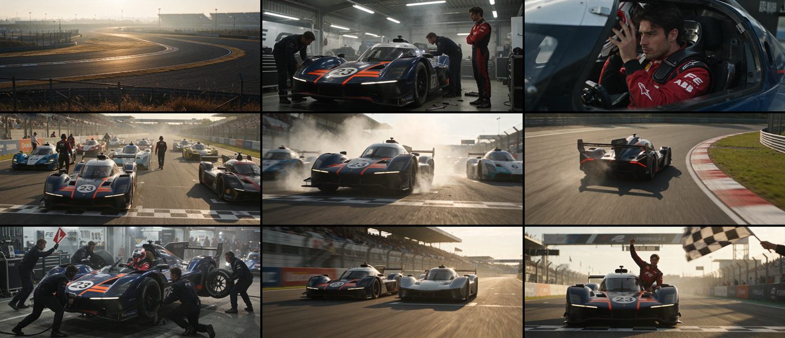
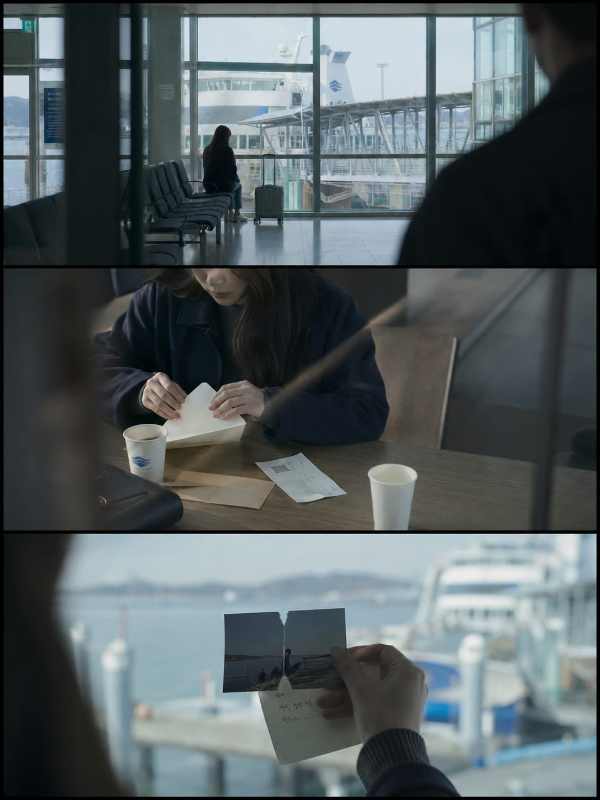

# CINEMA DNA

> **即梦版已提供：** [下载即梦技能 ZIP](https://github.com/dacnay816y62-hub/cinema-dna-21x9x3/releases/download/jimeng-v1.0.0/cinema-dna-21x9x3-jimeng-v1.0.0.zip) · [查看即梦版说明](jimeng/README.md)。上传即梦请使用此专用 ZIP；原版技能继续保留。


**版本：3.2.2**

### 电影感分镜 × 专业视频提示词 × HTML 工作台

**让每一个镜头都有理由，让画面之间发生故事。**

从一句剧情、一个人物或一张参考图出发，建立摄影机的位置、人物与空间的关系、光线和色彩，再把它发展成可以连续观看的电影画面。

**约 2.39:1 宽银幕 · 1 / 3 / 9 镜头 · 原画风保真 · Seedance 2.5 提示词 · TXT + HTML 交付**

[快速开始](#快速开始) · [固定中文提示词](#固定中文提示词) · [三种输出模式](#三种输出模式) · [工作流程](#工作流程) · [示例图库](#示例图库) · [安装与调用](#安装与调用)

## 新增实战案例：赛车短片

**“做个赛车电影吧。”——从一句话，到一个电影级短片雏形。**

剧情雏形 → 人物三视图 → 统一赛车 → 两版九镜分镜 → 实际视频片段。由 **FANTASY / 梵想美学** 创作与整理，附带原版标志的 HTML 案例页、6 页图文讲解和完整素材下载。

[](cases/赛车短片实战案例/README.md)

**[查看「赛车短片实战案例」](cases/赛车短片实战案例/README.md)** · **[下载完整案例包](https://github.com/dacnay816y62-hub/cinema-dna-21x9x3/releases/download/racing-case-v1.0.0/racing-short-film-case.zip)**

原始大图与视频独立发布，不打进技能安装附件；本次案例更新不改变现有技能版本。

| 家庭餐桌 · 距离与视线 | 雨夜赛场 · 身体与压力 |
| :---: | :---: |
|  |  |

## 它解决什么

电影感来自一个具体的判断：**摄影机为什么站在这里，这一刻为什么值得被看见。**

Cinema DNA 把这个判断落实到可执行的镜头设计：人物正在做什么，空间如何限制他们，观众先看到哪条信息，下一镜又改变了什么。颗粒、浅景深与综合色服务于这些关系。

**Skill 负责镜头与叙事设计、提示词和生成编排；图像模型负责逐镜生成；拼版工具负责组合已有镜头。** 它依赖所在环境实际提供的图像能力，本身不附带模型、API 密钥或视频生成服务。

## 3.2 更新重点

**3.2.2 中文正文固定：** 不仅有网页模板，也固定每段完整提示词的九个栏目。默认交付填好的中文正文，附单镜与多镜示例；工作台生成时检查缺栏、空栏、填空残留和英文字母。结合字节官方文档、Higgsfield 社区与用户提供的 LibTV 项目方法，分开记录来源与实际视频验收。

**3.2.1 模板补全：** 工作台 HTML 模板与生成脚本一同提供，加入 FANTASY 原版 logo、可打开示例及中文使用说明。无需自己搭页面，下载解压后即可查看。

**这次，连“怎么拍”一起交付。** 3.2.0 将此前独立 V3 的视频提示词工作流合并回原 Skill，安装名和仓库地址不变，保留 3.1.1 的单帧、三联、九镜、画风与空间能力。

- **完整中文视频提示词：** 把参考职责、起始状态、主体动作、运镜路径、落幅、光影与声音写成可以独立复制的正文，不再只交一张导演表或几句术语。
- **按剧情决定分段：** 分镜图数、剪辑镜头数和生成片段数分别规划；支持单镜连续、多镜剪辑、逐镜独立与已有视频延长，不把九张图机械绑成九次提交或一条长镜头。
- **专业运镜与连续性：** 区分机位位移、摇摄、变焦和移焦；明确动作交接、停顿、切点、前后状态及参考不继承的内容。
- **重点适配 Seedance 2.5：** 使用自然语言表达导演意图，网页与 API 分开核验；用户指定其他后端仍按实际入口适配。
- **可复制 HTML 工作台：** 分镜、镜号、参考用途、完整提示词同页查看，附复制与 TXT 下载；脚本使用 Python 标准库，可离线打开，不自动生成或付费提交视频。
- **轻量与可追溯：** 新增状态账本检查和工作台生成器，技能包保留六张轻量 JPG；不附带私人项目大图、原视频、密钥或研究缓存。另经作者明确授权发布的实战案例，在独立案例目录与下载包提供。

这一版吸收了镜头语言、连续性规则及公开社区案例的写法研究，整理为可复用流程；不是重新训练基础模型。提示词结构检查、案例抽帧观察与实际视频验收分开记录，不以规则存在或文字更长证明成片更好。

## 三种输出模式

| 模式 | 适合什么 | 交付结构 |
| --- | --- | --- |
| **单帧** | 先确定一个视觉方向或关键瞬间 | 1 张独立宽银幕画面 |
| **三联** | 一个事件中的三次信息变化 | 3 张独立镜头 + 1 张纵向三联图 |
| **九镜** | 展开连续动作、人物关系或一个完整短场景 | 9 张独立镜头 + 3 张三联图 + 1 张 3×3 总览 |

未指定数量时默认三联；明确要求九镜或九宫格时使用九镜，不因为“导演感”或转视频就自动扩镜。你指定的数量和交付形式优先。

仓库名称中的 **21:9** 表示宽银幕方向，当前镜头提示词以 **约 2.39:1** 为默认目标。严格的 21:9 与 2.39:1 并不相等；有精确尺寸要求时请直接指定。九宫格中的每格仍是横向宽银幕镜头，整张总览不必是正方形。

## 快速开始

不必先填写复杂表格。给出题材、一个正在发生的事件，以及最重要的限制，就可以开始。

### 先试一组三联

```text
使用 $cinema-dna-21x9x3。
清晨的老公寓，一家人已经开始吃饭，一个人却迟迟没有入座。
生成三个连续镜头，暖色自然光，人物始终在做事。
三个镜头要有不同的观看位置，保留独立源图，再拼成纵向三联。
```

### 用九镜讲一个短场景

```text
使用 $cinema-dna-21x9x3，生成九镜故事板。
暴雨将至，村民准备收起露天戏台，一名演员仍坚持把最后一段演完。
先把故事因果和人物、服装、戏台位置锁定，再逐镜生成。
不要依靠字幕解释剧情，不要让九张图都是同一个角度。
交付九张独立镜头、三组三联和一张 3×3 总览。
```

### 只要镜头方案与提示词

```text
使用 $cinema-dna-21x9x3。
设计一组雨中赛车的三联镜头，强调速度、视线阻挡和赛场压力。
只给精简的中文镜头说明与完整中文提示词，不生成图片。
```

### 保留原画风，并交付视频运镜提示词

```text
使用 $cinema-dna-21x9x3，按上传图的手绘画风做九镜。
参考只用于画风和人物身份，不要把原图裁切当某一帧。
保留我已经认可的第一镜，补齐其余镜头，并检查角色与道具状态。
用官方内置 Image Gen，不切换其他图像服务。
交付中文文件夹、独立图、完整中文视频提示词和可复制 HTML 工作台，提示词用 TXT，不要 MD。
只做图片和提示词，不生成视频。
```

### 只修一张失败镜头

```text
第 5 镜的人物服装和第 1 镜不一致。
只修第 5 镜，保留它原有的剧情功能、动作、机位和光线。
其他镜头不重做，替换完成后重新拼版。
```

### 已有分镜，直接组织视频提示词

```text
使用 $cinema-dna-21x9x3。
根据上传的分镜和剧情，判断适合分成几段视频，不需要先让我选两段还是三段。
以 Seedance 2.5 为主，每段给一条独立完整的中文提示词。
写清参考图职责、动作起止、摄影机路径、切镜、光影与声音，保留原画风和人物关系。
交付中文文件夹、TXT 和带复制按钮的 HTML 工作台。
只做提示词与文件，不生成或购买视频。
```

### HTML 工作台怎么用

打开 `分镜与提示词.html` → 查看本段分镜与参考用途 → 复制完整提示词 → 按上传清单绑定素材 → 在所选视频平台生成。

页面不依赖 CDN，附 TXT 下载；本地浏览器限制剪贴板时会提供可手动选择的正文。工作台本身不是视频模型，也不包含自动付费提交。已有真实视频才显示播放器。

维护者可用 `python scripts/build_prompt_html.py 任务目录/交付清单.json` 从已有分镜与 TXT 生成工作台；清单格式与路径规则见[交付规范](references/delivery-contract.md)。

**下载与示例：** [最新版 Release](https://github.com/dacnay816y62-hub/cinema-dna-21x9x3/releases/latest) · [中文使用教程 TXT](工作台使用说明.txt) · [工作台示例文件](examples/分镜与提示词.html) · [HTML 模板源码](assets/prompt-workspace/template.html) · [示例数据清单](examples/工作台示例.json)。GitHub 文件页展示的是源码；下载并完整解压 ZIP 后，双击 `examples/分镜与提示词.html` 才是实际工作台。

可以直接对 Codex 说：

```text
使用 cinema-dna-21x9x3 的分镜提示词工作台模板，把我的分镜图与完整视频提示词对应整理成 HTML。按剧情合理分段，写清参考用途、镜号、动作与运镜。保留 FANTASY logo，交付中文文件夹、TXT 和可复制提示词的 HTML；使用技能自带模板与脚本，不另外重写网页，也不要提交或购买视频。
```

工作台示例复用仓库已有的三联图，正文为使用演示，不代表对应视频已经生成。生成器内嵌 logo，图片、TXT 和视频仍保持相对路径；分享时请发送完整任务目录。修改 TXT 后需要重建 HTML。

## 固定中文提示词

**每段默认给一份填好的正文，不让使用者自己拼接。** 固定栏目为：

片段任务 → 素材绑定 → 场景与起始状态 → 分镜时间轴 → 摄影机与焦点 → 表演与物理反馈 → 光线与画风 → 声音与台词 → 结束状态与限制。

九栏不等于九镜。镜头数、生成段数和时间长度仍按剧情决定。正文中的动作、运镜、对白与限制全部中文；平台实际附件标签、原文件名和代码字段保留在正文外的上传说明中。用户明确指定其他格式时优先尊重用户。

- [空白提示词模板（文本）](assets/提示词模板/完整视频提示词模板.txt)：供编写时填写，默认不把空白版当最终成果。
- [完整多镜示例：雨夜开球](examples/工作台示例/完整视频提示词.txt) 与 [完整单镜示例：檐下递灯](examples/中文提示词示例/檐下递灯.txt)。
- [固定格式与来源说明](references/中文固定模板规范.md)：官方能力边界、社区方法及中文交付规则。
- [结构检查器](scripts/check_prompt_template.py)：只检查结构与语言，不验证视频质量。

新版工作台默认拒绝缺栏、空栏、填空残留或英文正文。用户明确要求整理旧稿或自定格式时，才在该片段清单中添加 `"prompt_format": "自由格式"`。旧清单未填此字段时按新版中文固定模板检查；这项兼容选项不等于内容已验收。

## 工作流程

**故事与参考 → 镜头设计 → 按需生成独立图 → 连续性检查 → 视频提示词编排 → TXT / HTML 交付**

| 阶段 | 解决的问题 | 形成的依据 |
| --- | --- | --- |
| **明确事件** | 原故事发生了什么？ | 保留已给定事件、关系与结局，不强加冲突或代价 |
| **锁定连续性** | 什么保持、什么随事件改变？ | 画风、身份与逐镜状态分开，记录道具归属和空间依据 |
| **安排镜头** | 每一镜让观众多知道了什么？ | 动作、观看位置、构图、线索与前后变化 |
| **逐镜生成** | 怎样保留单独修改的能力？ | 各自独立的源图与对应提示词 |
| **检查与修正** | 哪一镜破坏了故事或身份？ | 对具体镜头补跑，保留已经成立的画面 |
| **拼版交付** | 怎样让镜头按正确顺序被观看？ | 三联或九宫格，以及可继续使用的独立源图 |

九镜可按 **1–3 / 4–6 / 7–9** 组织队列，但关键状态变化镜先验收，再生成依赖它的镜头。已认可且符合故事的镜头可以保留。分批与数量不是连续性证明；不会要求图像模型直接在一张画布里画出九宫格。

## 设计规则

| 规则 | 对画面的实际要求 |
| --- | --- |
| **先有动作，再有气氛** | 用等待、递交、转身、阻挡等可见事件承载剧情 |
| **构图有理由** | 机位来自人物关系、空间限制和观众的观看立场 |
| **视线有去处** | 明确视线从哪里进入、被什么阻挡、最终落在哪里 |
| **每镜有信息变化** | 换角度之外，还要推进动作、关系或观众认知 |
| **连续性有基准** | 用少量稳定特征锁定人、物与空间，避免装饰越多越容易漂移 |
| **色彩有来源** | 颜色来自服装、墙体、天气与实景灯，而非统一滤镜 |
| **质感服从媒介** | 摄影保留可信材质，手绘保留原线条与色块；不以套电影滤镜替代画风保真 |
| **结尾有余地** | 第三镜可以是人物反应、关系变化或继续运行的现场，不固定成空场物件 |

九镜会检查原事件覆盖、人物身份、道具状态和镜头衔接；安静观察与必要过渡也可以成立，不强制增加发现、代价或反转。具体执行规则见 [SKILL.md](SKILL.md) 与[九镜协议](references/nine-shot-story-protocol-v3.md)。

## 示例图库

以下是仓库保留的 **6 组三联案例**，用于观察镜头关系、构图和画面质感。它们不是九镜示例，也不代表当前版本对所有题材都已完成验证。仓库未提供完整的逐图生成记录，因此不推定各图使用的模型版本或原始提示词。

首页两组分别展示家庭餐桌和雨夜橄榄球；另外四组如下。点击图片可查看完整尺寸。

| 马术场 · 栏杆与运动方向 | 冰原矿城 · 队列与制度空间 |
| :---: | :---: |
|  |  |

| 候车室来信 · 窗口与信息 | 列车离别 · 内外与停顿 |
| :---: | :---: |
|  |  |

## 片名与海报：按需追加

需要发布作品时，可以在已确认的故事板基础上继续要求：

```text
根据这组已经确认的镜头，给出中文片名候选和一句故事介绍。
再设计一张 3:4 竖版主题海报，主视觉来自故事里的核心关系。
准确的片名与小字通过排版叠加，不要直接把分镜简单拼贴成海报。
```

这个阶段只在你明确要求时启用。主海报默认 **3:4**，16:9、1:1、9:16 可作为后续封面扩展。参考海报用于分析版式方法、视觉层级和字体气质，具体人物、文字和故事内容根据当前项目设计。

## 安装与调用

**[下载当前版本 ZIP](https://github.com/dacnay816y62-hub/cinema-dna-21x9x3/archive/refs/heads/main.zip)** · **[查看历史版本](https://github.com/dacnay816y62-hub/cinema-dna-21x9x3/releases)**

将解压后包含 `SKILL.md` 的文件夹放入所用助手的技能目录。当前仓库保留轻量 JPG 示例；旧版 Release 包含更大的历史图库。

### 直接发给 Codex 的安装口令

```text
帮我从 https://github.com/dacnay816y62-hub/cinema-dna-21x9x3 安装或更新 Cinema DNA skill；如果已安装，先检查并保留本地自定义修改。
```

安装完成后，可直接说“用电影感 skill 做一组九镜，附中文视频运镜提示词”。

### Codex CLI

已安装 Git 时，可直接克隆到技能目录。`--depth 1` 只下载当前历史深度，避免首次安装拉取全部旧图。

**Windows PowerShell：**

```powershell
$skillRoot = Join-Path $env:USERPROFILE '.agents\skills'
New-Item -ItemType Directory -Force -Path $skillRoot | Out-Null
git clone --depth 1 https://github.com/dacnay816y62-hub/cinema-dna-21x9x3.git (Join-Path $skillRoot 'cinema-dna-21x9x3')
```

**macOS / Linux：**

```bash
git clone --depth 1 https://github.com/dacnay816y62-hub/cinema-dna-21x9x3.git "$HOME/.agents/skills/cinema-dna-21x9x3"
```

目标文件夹已存在时，先确认它是否属于这个仓库，避免覆盖自己的修改。安装后在支持技能调用的对话中使用 **`$cinema-dna-21x9x3`**。

### 运行环境

- **生成图像：** 使用所在环境实际提供、或用户指定的图像工具；没有可用后端时交付镜头方案与提示词，并说明未生成图片。
- **九镜拼版：** 仓库附带的脚本基于 PowerShell 与 `System.Drawing`，建议在 Windows 环境执行。其他环境可使用可用的等效拼版工具，保持顺序、比例和独立源图。
- **HTML 与状态检查脚本：** Python 3.9+，仅使用标准库，无 API 密钥或第三方依赖；网页文件与关联素材应一起移动。
- **仅要提示词：** 不需要图像生成服务，明确说“只要提示词，不出图”即可。

## 文件导航

| 文件 | 用途 |
| --- | --- |
| [SKILL.md](SKILL.md) | 单帧、三联与九镜的核心执行规则 |
| [画风保真](references/style-reference-fidelity.md) | 参考用途、原媒介保持与已批准校准帧 |
| [剧情与状态](references/story-state-continuity.md) | 事件还原、实体化角色、道具归属 |
| [资产与空间](references/asset-space-protocol.md) | 轴线、脚点、比例与未知区域 |
| [视频运镜协议](references/video-motion-protocol.md) | 输入帧角色、主体动作、相机路径与切镜 |
| [视频提示词示例](references/video-prompt-examples.md) | 按需参考的单镜表达片段，不能替代完整正文 |
| [提示词写作方法](references/prompt-writing.md) | 完整正文、参考职责、动作与相机编排 |
| [中文固定模板规范](references/中文固定模板规范.md) | 九栏完整正文、来源与默认交付门槛 |
| [空白中文提示词模板](assets/提示词模板/完整视频提示词模板.txt) | 编写用填空版，最终交付必须填完 |
| [中文提示词检查器](scripts/check_prompt_template.py) | 检查缺栏、空栏、占位符与英文残留 |
| [导演与连续性](references/director-workflow.md) | 空间、首尾状态、轴线与声音 |
| [Seedance 2.5 入口](references/seedance-25-profile.md) | 按实际网页/API 核对能力，不虚构参数 |
| [研究来源](references/research-notes.md) | 社区案例方法、来源及证据边界 |
| [交付规范](references/delivery-contract.md) | 中文目录、完整 TXT 与可复制 HTML |
| [HTML 生成器](scripts/build_prompt_html.py) | 将本地分镜与 TXT 组织成离线工作台 |
| [HTML 模板](assets/prompt-workspace/template.html) | 深色分镜与提示词布局、复制交互与使用提示 |
| [工作台使用说明](工作台使用说明.txt) | 直接发给 Codex 的口令、手动运行、改稿及分享方法 |
| [可打开示例](examples/分镜与提示词.html) | 下载完整仓库后双击查看 |
| [FANTASY 品牌资产](assets/fantasy-brand/brand-spec.md) | 用户授权发布的原版 logo 与显示规则 |
| [状态检查器](scripts/check_plan.py) | 声明的时间、引用和状态链检查，不验证画面 |
| [人工回归用例](tests/regression-cases.txt) | 更新后需检查的行为边界，不是已完成性能测试 |
| [九镜故事协议](references/nine-shot-story-protocol-v3.md) | 故事推进、连续性、镜头变化与逐镜恢复 |
| [摄影质感与节奏](references/cinema-dna-v4-anti-ai.md) | 光学质感、细节控制与三联节奏 |
| [单帧与三联方法库](references/cinema-dna-full-spec.md) | 焦段、构图、光线与题材参考；冲突时以核心规则为准 |
| [九镜拼版脚本](scripts/compose-nine-shot-storyboard.ps1) | 组织 9 张源图、3 张三联图和 1 张总览 |
| [调用配置](agents/openai.yaml) | 技能展示名称与默认调用示例 |

## 常见问题

**为什么不直接让模型画九宫格？**

独立生成便于核对人物、镜头和空间，也便于只替换出错的一张。拼版应组合已完成的镜头，保持内容可追溯。

**九张都好看，就算成功吗？**

还要看顺序是否有意义、动作是否推动结果、人物和道具是否连续。Skill 可以帮助搭建故事概念和镜头方案，深入创作仍需要你判断剧本是否合理。

**能保持人物百分之百一致吗？**

不能据此承诺。角色基准、参考图和连续性清单有助于减少漂移，实际结果仍需逐镜检查，必要时局部修正或补跑。

**它会生成视频吗？**

可以按剧情组织独立完整的视频提示词，重点适配 Seedance 2.5，附实际参考职责、相机路径、首尾状态、切点与声音。文件交付可提供 TXT 和可复制 HTML。实际视频仍需要用户明确要求与可用后端；没有生成时只标注“提示词已检查，运动未验证”。

**画面太脏、太油或太像游戏怎么办？**

指出具体镜号和问题，保留已经成立的构图与动作，再减少过度锐化、均匀磨损、无来源光效和装饰性细节。问题通常需要可见的修正目标，而不只是追加一句“更电影感”。

**特写太多，反而看不清故事怎么办？**

明确写“不要面部、手部或物件特写，以能看清动作和空间关系的镜头为主”。Skill 应优先遵循你的景别限制，不为了画面精致而插入无助于剧情的细节镜头。

## FANTASY / 梵想美学

**让想象先被看见。**

Skill 帮助组织视觉判断和模型工具。好的剧本与好的画面共同组成作品，创作者的观察、取舍和判断仍然贯穿整个过程。

反馈可提交到 [Issues](https://github.com/dacnay816y62-hub/cinema-dna-21x9x3/issues)，附上题材、所用工具、出错镜号和希望保留的内容。公开示例请使用已获准分享的素材，并清理私人资料与图片元数据。

当前仓库未附加许可证。本次发行版为 [v3.2.2](https://github.com/dacnay816y62-hub/cinema-dna-21x9x3/releases/tag/v3.2.2)；历史发行版仍保留，主分支文档可继续更新。FANTASY logo 用于本项目品牌识别，不代表授权第三方商标使用或品牌背书。

---

**让想象先被看见。** 将视觉判断与创作流程整理成可以继续使用的方法。

**[浏览全部视觉 Skills](https://github.com/dacnay816y62-hub?tab=repositories)** · [Fantasy Movie Poster](https://github.com/dacnay816y62-hub/fantasy-movie-poster-skill) · [Character Casting Studio](https://github.com/dacnay816y62-hub/character-casting-studio-skill)

本地技能目录与加载方式参见 [OpenAI 官方 Skills 文档](https://learn.chatgpt.com/docs/build-skills#where-codex-loads-local-skills)。
