# 赛车短片实战案例

**“做个赛车电影吧。”**

从一句话，到一个电影级短片雏形。把剧情、人物资产、赛车外观、分镜与视频生成，组织成可以继续制作的一条流程。

**创作与案例整理：FANTASY / 梵想美学**

[下载完整案例包](https://github.com/dacnay816y62-hub/cinema-dna-21x9x3/releases/download/racing-case-v1.0.0/racing-short-film-case.zip) · [案例发行页](https://github.com/dacnay816y62-hub/cinema-dna-21x9x3/releases/tag/racing-case-v1.0.0) · [获取即梦版技能](../../jimeng/README.md) · [返回电影感 Skill](../../README.md)

<p align="center">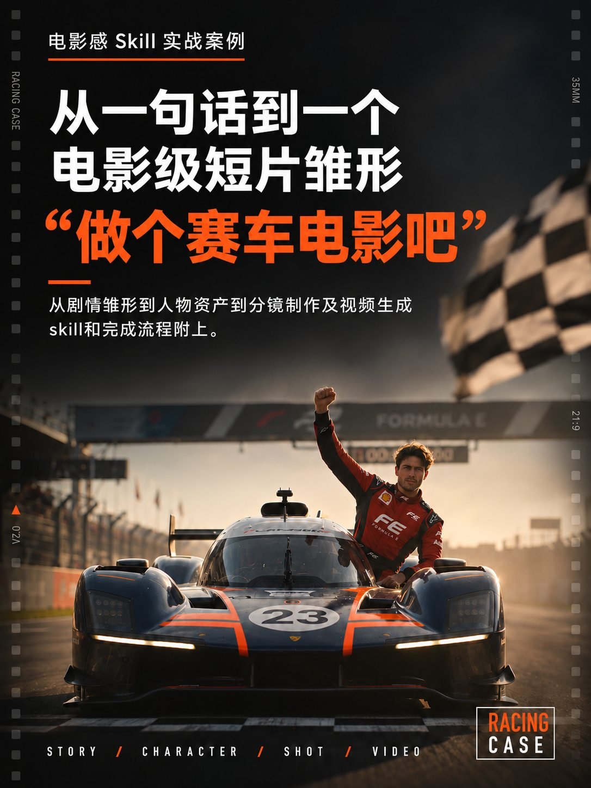</p>

## 这次公开什么

| 内容 | 收录范围 |
| --- | --- |
| 剧情与分镜 | 第一版概念九宫格、第二版资产统一九宫格 |
| 人物资产 | 头肩三视图、全身与服装三视图 |
| 独立画面 | 13 张分镜，覆盖准备、比赛、团队交流与庆祝 |
| 实际视频 | 14 个原始文件，去重后展示 13 段 |
| 制作讲解 | 6 页原讲解图、中文流程与使用方法 |
| 浏览方式 | 带原版 FANTASY 标志与署名的 HTML 案例页，可离线播放并对照分镜 |

原始素材和视频放在独立案例下载包中，仓库只保留轻量预览与说明。本次是案例更新，**不修改 3.2.2 核心版本或即梦版 1.0.0 技能包**。

## 01 / 只说一句话，先把赛车电影的雏形搭出来

先建立“准备—发车—比赛—进站—冲线”的剧情线，用第一版九镜看影调、空间与节奏。这一步的价值不是每张都完美，而是让一个抽象想法先有可讨论的电影长相。

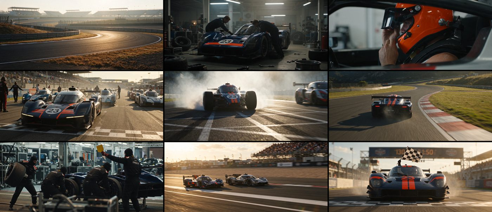

## 02 / 接着，给故事建立一个主角

头肩三视图锁定五官、发型与胡茬，全身三视图核对身材、服装与头盔。让人物资产承担明确职责，后面的车库、座舱和领奖镜头才有共同参照。

| 头肩三视图 | 全身与服装三视图 |
| :---: | :---: |
| 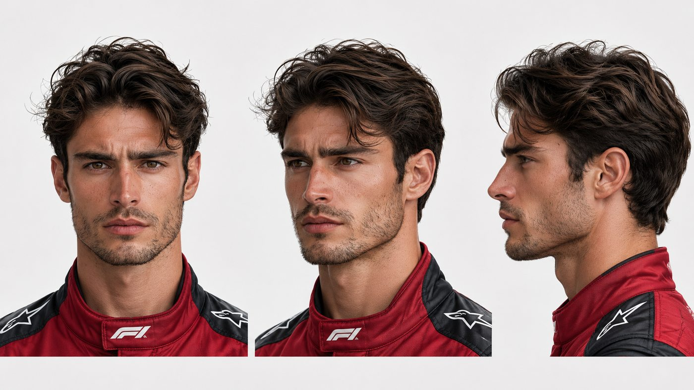 | 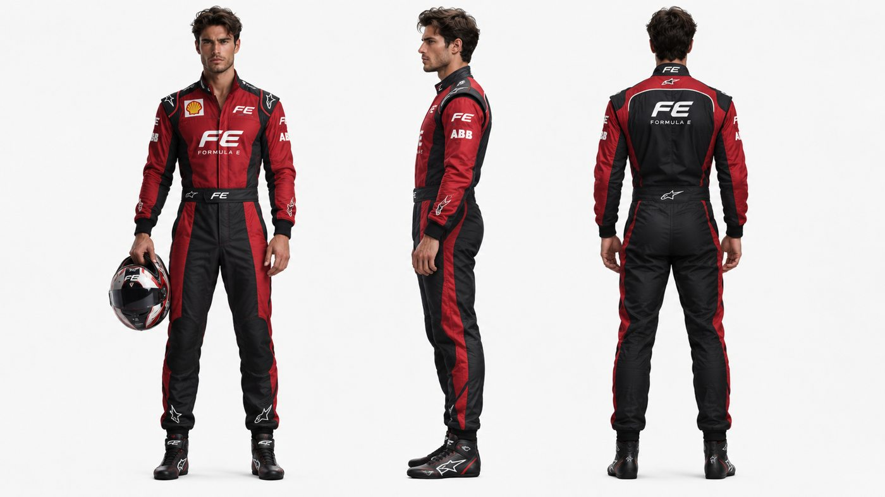 |

**人物资产，是剧情视频连续性的基础之一。** 资产约束有助于减少漂移，实际生成仍需逐镜检查。

## 03 / 但只统一人物还不够：车也要统一

本案例把深蓝车身、荧光橙条纹、白色圆形号码与 23 号标识作为主要核对项，并补充主角入镜：在车库等待、进入座舱、戴盔，再到赛后庆祝。

| 人物与赛车同场 | 主角进入行动 |
| :---: | :---: |
| 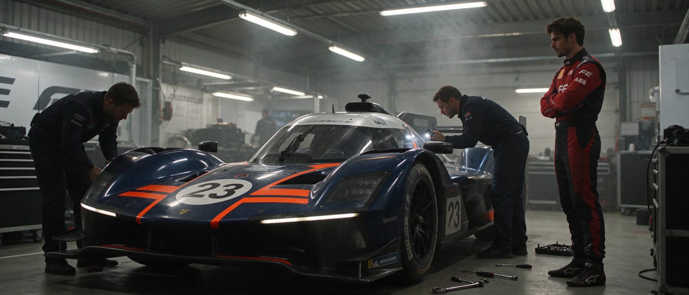 | 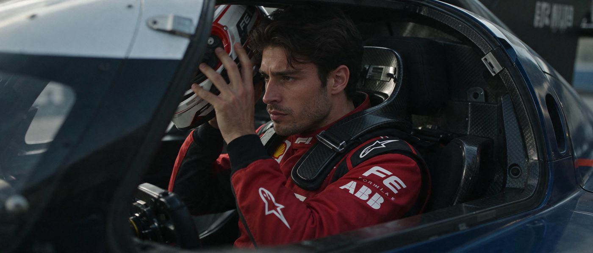 |

不是不断重写一大段形容词，而是针对画面里已经出现的问题，补充明确的资产与动作约束。

## 04 / 九镜，不只是九张好看的图

**它是一支短片的静帧骨架。** 准备段交代人物与空间，比赛段交代动作与竞争，收束段交代结果。第二版保留故事方向，同时统一主要赛车外观、补充人物戏份。

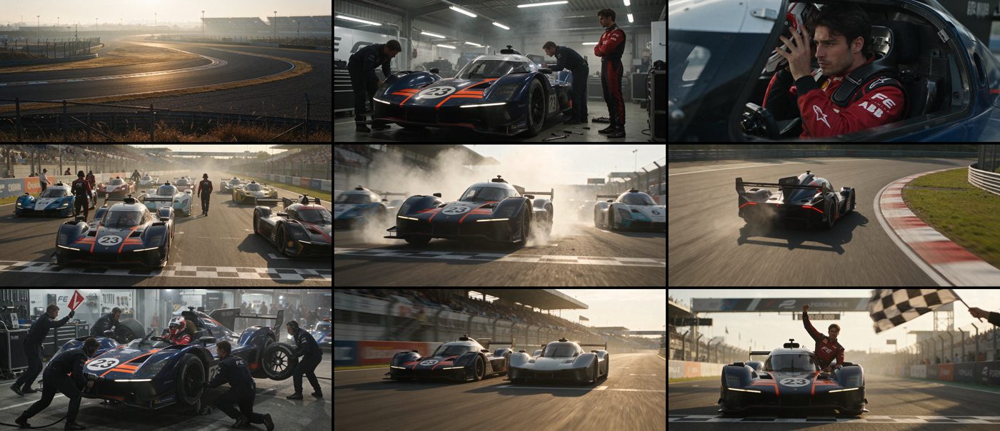

九宫格之外，还保留了团队交流、驾驶舱和领奖等扩展镜头。**九张分镜、视频生成段数、最终剪辑镜头数，是不同的数量。** 不必机械地一一绑定。

## 05 / 最后，把分镜与提示词交给视频模型

分镜确定输入画面；视频提示词负责动作起止、摄影机路径、焦点变化、停顿与落幅。生成后再检查人物、赛车外形与运动方向，筛选可用片段进入剪辑。

下面的视频来自本次提供的实际文件。点击“播放 / 下载”可打开单段；完整包内的 HTML 可以直接播放、查看分镜并追溯原文件。

| 顺序 | 画面 | 视频与叙事功能 |
| --- | --- | --- |
| 01 黎明赛道 | 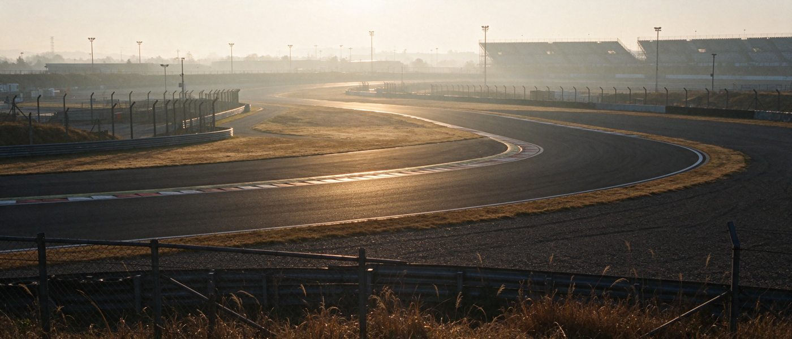 | [播放 / 下载](https://github.com/dacnay816y62-hub/cinema-dna-21x9x3/releases/download/racing-case-v1.0.0/racing-01.mp4) · 建立空间与晨光 |
| 02 车库准备 |  | [播放 / 下载](https://github.com/dacnay816y62-hub/cinema-dna-21x9x3/releases/download/racing-case-v1.0.0/racing-02.mp4) · 交代主角与赛车 |
| 03 戴盔入场 |  | [播放 / 下载](https://github.com/dacnay816y62-hub/cinema-dna-21x9x3/releases/download/racing-case-v1.0.0/racing-03.mp4) · 将准备推向行动 |
| 04 赛前交流 | 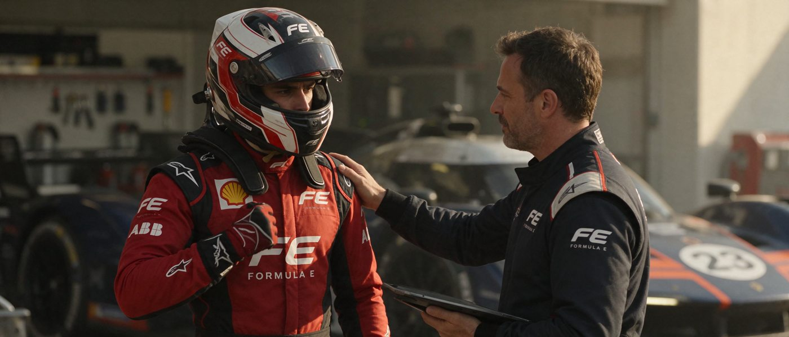 | [播放 / 下载](https://github.com/dacnay816y62-hub/cinema-dna-21x9x3/releases/download/racing-case-v1.0.0/racing-04.mp4) · 补充团队关系 |
| 05 发车列阵 | 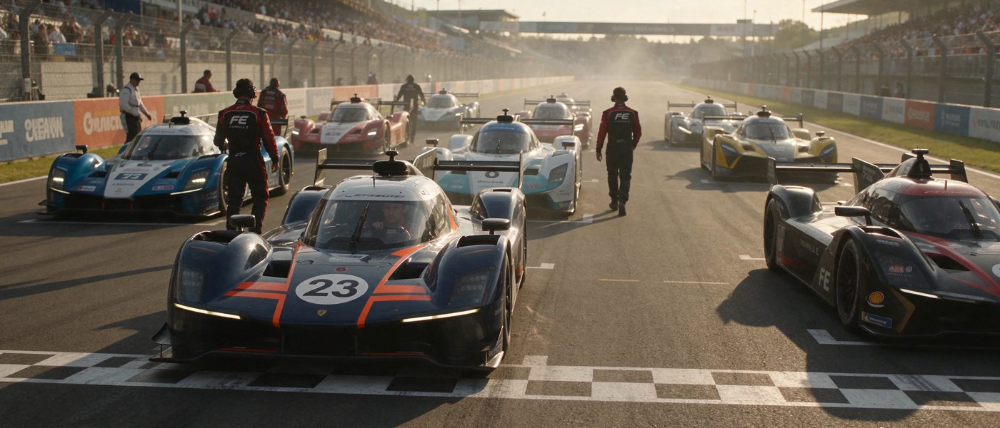 | [播放 / 下载](https://github.com/dacnay816y62-hub/cinema-dna-21x9x3/releases/download/racing-case-v1.0.0/racing-05.mp4) · 建立赛车排列与方向 |
| 06 起步冲刺 | 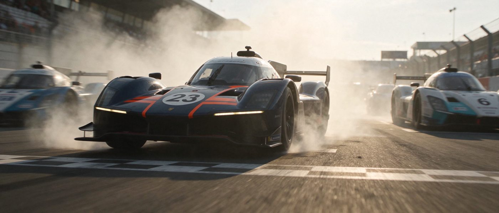 | [播放 / 下载](https://github.com/dacnay816y62-hub/cinema-dna-21x9x3/releases/download/racing-case-v1.0.0/racing-06.mp4) · 传递起步力量 |
| 07 高速过弯 | 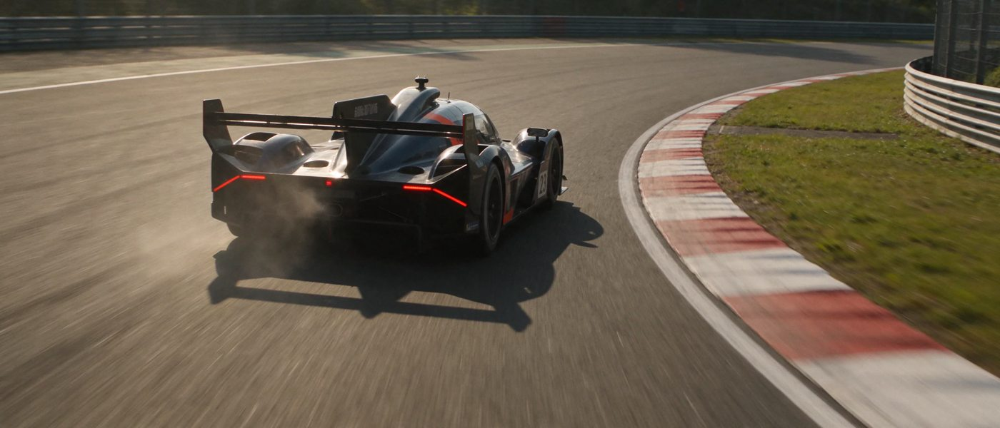 | [播放 / 下载](https://github.com/dacnay816y62-hub/cinema-dna-21x9x3/releases/download/racing-case-v1.0.0/racing-07.mp4) · 用路肩提供速度参照 |
| 08 进站换胎 | 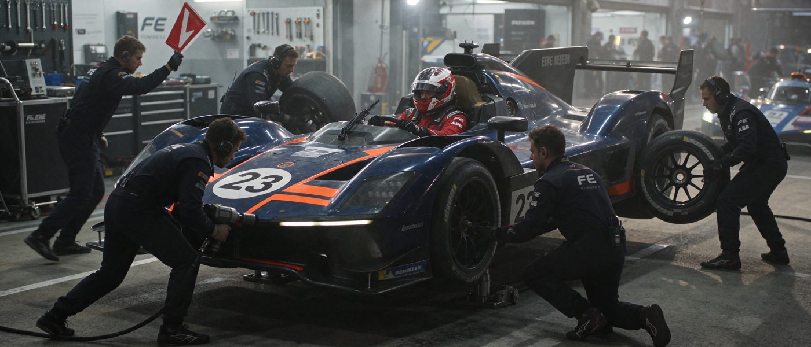 | [播放 / 下载](https://github.com/dacnay816y62-hub/cinema-dna-21x9x3/releases/download/racing-case-v1.0.0/racing-08.mp4) · 看见维修团队协作 |
| 09 驾驶舱表演 | 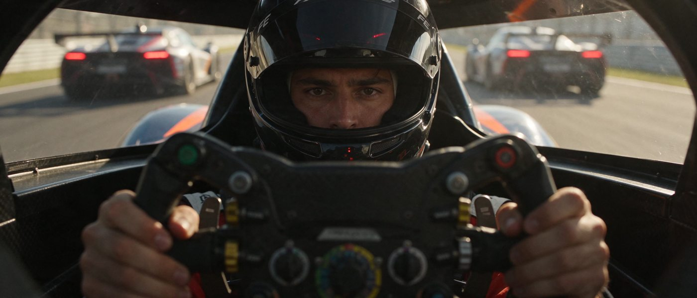 | [播放 / 下载](https://github.com/dacnay816y62-hub/cinema-dna-21x9x3/releases/download/racing-case-v1.0.0/racing-09.mp4) · 目光与方向盘的压力 |
| 10 座舱追击 | 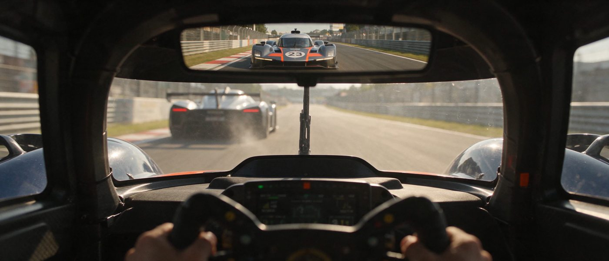 | [播放 / 下载](https://github.com/dacnay816y62-hub/cinema-dna-21x9x3/releases/download/racing-case-v1.0.0/racing-10.mp4) · 前车与后视镜关系 |
| 11 直道并行 | 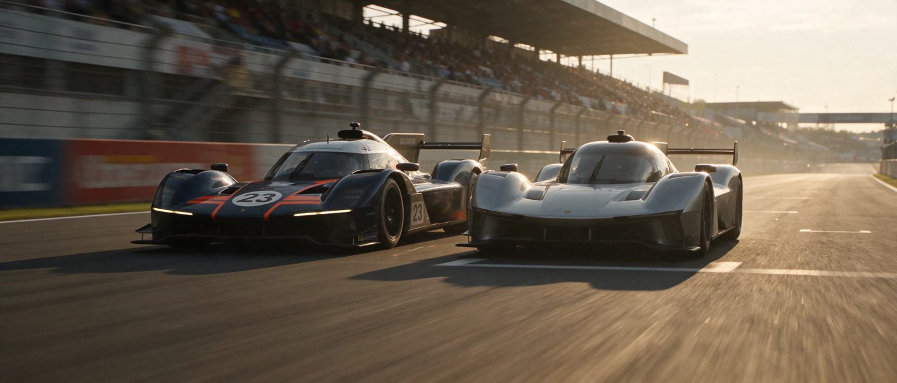 | [播放 / 下载](https://github.com/dacnay816y62-hub/cinema-dna-21x9x3/releases/download/racing-case-v1.0.0/racing-11.mp4) · 同框竞争 |
| 12 冲线庆祝 | 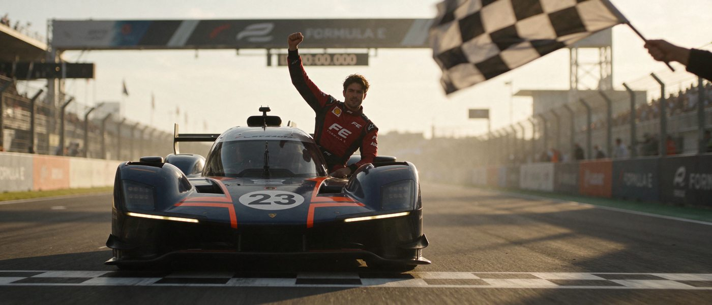 | [播放 / 下载](https://github.com/dacnay816y62-hub/cinema-dna-21x9x3/releases/download/racing-case-v1.0.0/racing-12.mp4) · 赛车与举拳共同收束 |
| 13 领奖收束 |  | [播放 / 下载](https://github.com/dacnay816y62-hub/cinema-dna-21x9x3/releases/download/racing-case-v1.0.0/racing-13.mp4) · 人物与现场情绪 |

## 六页图文讲解

沿用用户提供的黑底、橙色大字、胶片边缘与讲解顺序。HTML 展示页统一加入原版 FANTASY 标志和“梵想美学”署名，原讲解图保留不覆盖。

| 先把雏形搭出来 | 建立主角 | 统一赛车 |
| :---: | :---: | :---: |
| 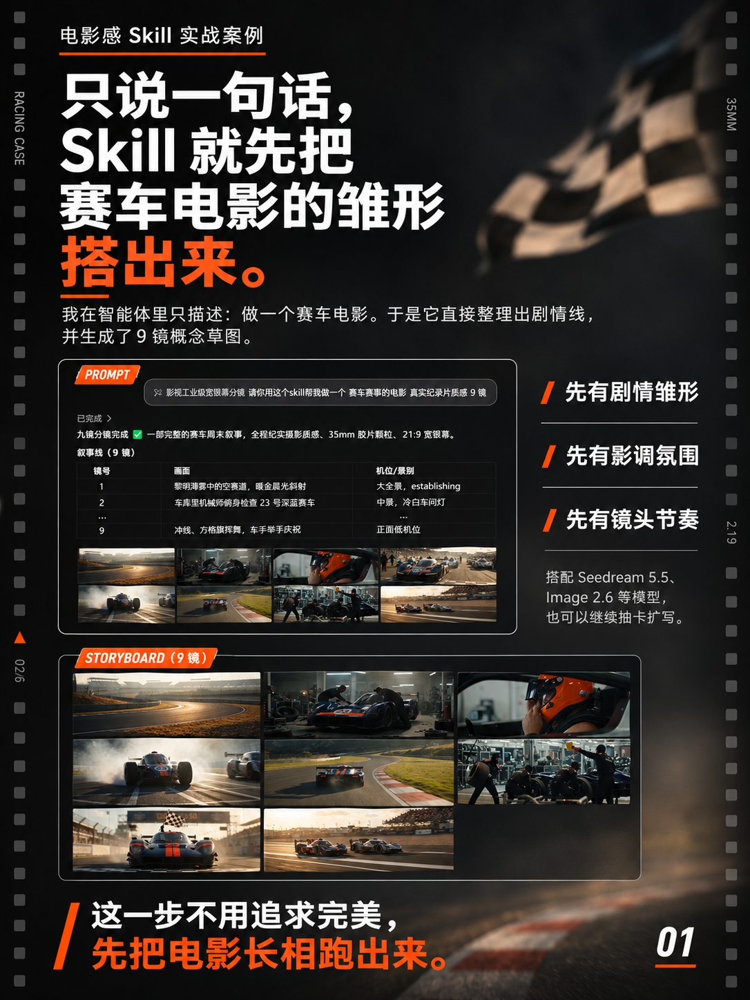 | 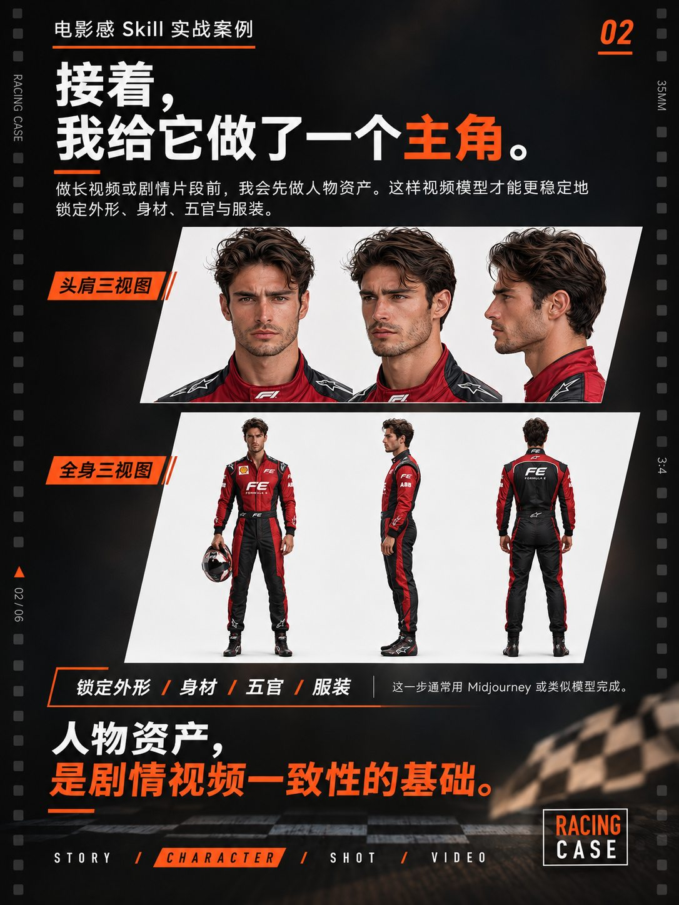 | 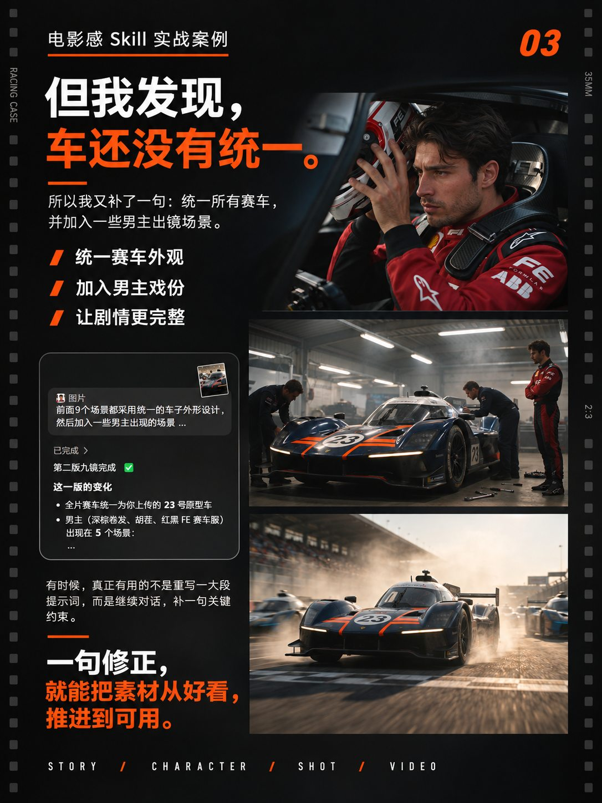 |

| 完整分镜骨架 | 视频生成流程 |
| :---: | :---: |
| 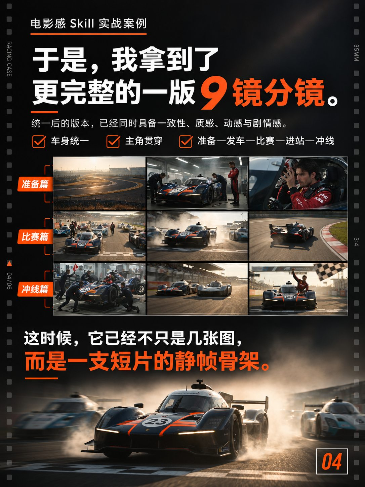 | 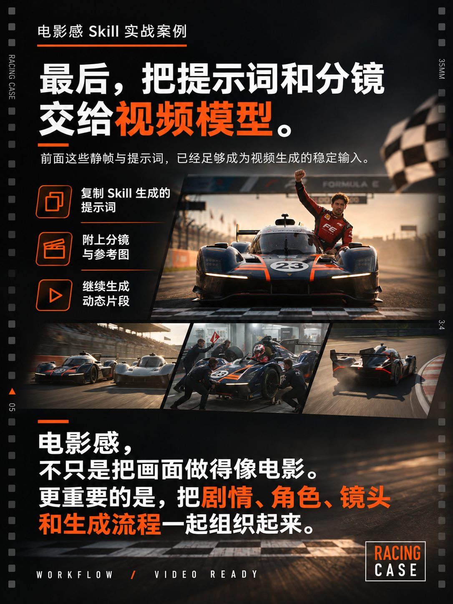 |

## 下载后怎么用

1. 下载 [赛车短片实战案例完整包](https://github.com/dacnay816y62-hub/cinema-dna-21x9x3/releases/download/racing-case-v1.0.0/racing-short-film-case.zip)，完整解压。
2. 双击 `赛车短片实战案例.html`。页面、标志、预览和视频都在包内，可离线查看。
3. 展开视频下方的“查看对应分镜与源文件”，核对每段输入与输出；原始文件位于中文目录 `原始素材`。
4. 开始自己的项目时使用 [即梦版技能](../../jimeng/README.md) 或 [原版技能](../../README.md)，按剧情重新规划，而不是复制这个案例的赛车设定。

GitHub 的 HTML 文件页展示源码，不是在线播放页。完整包内的页面使用本地视频；仓库中的 [HTML 文件](赛车短片实战案例.html) 使用本次 Release 的视频链接。

### 直接可用的调用口令

```text
请使用电影感分镜技能，参考赛车短片实战案例的制作方法，设计一个新的赛车故事。
先建立剧情与九镜概念，再分别锁定人物身份、服装和赛车外形，检查后输出独立分镜。
视频提示词使用全中文固定九栏模板，逐段写清素材职责、动作、机位、运镜、落幅与声音。
交付完整中文文本和带标志的网页工作台。先完成分镜与提示词，不自动提交或购买视频。
```

### 素材说明

- 原始文件共 37 个，完整包保留原文件名与原始字节；[素材清单](素材清单.json) 记录尺寸、摘要值和对应关系。
- 视频 2046 与 9139 的 SHA-256 相同，展示时只计一次，原文件均保留。
- 实测视频为 **992 × 432、每段约 4.06 秒**（浏览器媒体时长）。文件名中的“3.5 秒 / 4K 目标”不代表实际导出规格。
- 当前是分镜与分段视频案例，不冒称已交付一条完整剪辑成片。浏览顺序按讲解材料和画面内容组织。
- 源文件夹未包含独立的完整原始提示词。文件名是截断的，不作为完整生成记录；本次不补写并冒称原始提示词。新任务使用[固定中文模板](../../assets/提示词模板/完整视频提示词模板.txt)与[工作台说明](../../工作台使用说明.txt)。
- 角色服装与场景中出现的赛事、车队、产品标识，仅是示例画面内容，不表示合作、授权或背书。FANTASY 标志用于本项目署名，不授予第三方冒用品牌的权利。

---

<p align="center"></p>

<p align="center"><strong>创作与案例整理 · FANTASY / 梵想美学</strong><br>让想象先被看见。</p>
