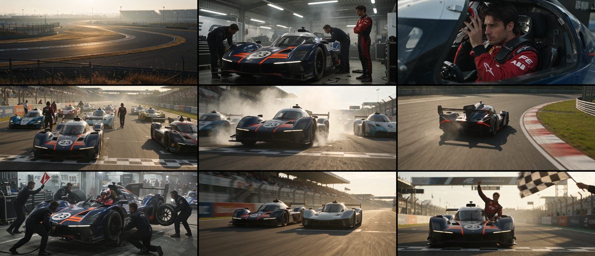

# 影视工业级宽银幕分镜 · 即梦版

[下载可上传的 ZIP](https://github.com/dacnay816y62-hub/cinema-dna-21x9x3/releases/download/jimeng-v1.0.0/cinema-dna-21x9x3-jimeng-v1.0.0.zip) · [发布说明](https://github.com/dacnay816y62-hub/cinema-dna-21x9x3/releases/tag/jimeng-v1.0.0) · [技能正文](%E5%BD%B1%E8%A7%86%E5%B7%A5%E4%B8%9A%E7%BA%A7%E5%AE%BD%E9%93%B6%E5%B9%95%E5%88%86%E9%95%9C/SKILL.md)

下载发布附件 ZIP 后上传到即梦的技能导入入口。包内只有一个与技能 name 一致的根目录，根目录包含 SKILL.md。不要把整个仓库的 Source code ZIP 当作即梦技能包。

原版技能仍在仓库根目录；即梦版独立维护在本目录。

## 赛车短片实战案例

**“做个赛车电影吧。”** 从剧情雏形到人物资产，再统一赛车、展开分镜并生成视频片段。

[查看完整图文案例](../cases/赛车短片实战案例/README.md) · [下载素材与离线 HTML](https://github.com/dacnay816y62-hub/cinema-dna-21x9x3/releases/download/racing-case-v1.0.0/racing-short-film-case.zip)

创作与案例整理：**FANTASY / 梵想美学**。包含两版九宫格、人物三视图、13 张独立分镜、13 段去重后的视频及六页讲解。原始视频和大图独立下载，不增加即梦技能 ZIP 的体积。

案例中的生成结果来自作者提供的素材；它不是即梦上传兼容性的证明，也不改变下方既有安装包的检查记录。

## 版本说明

本版统一中文入口、自然能力描述与按需参考，保留用户明确的画幅、数量、风格和模型偏好，并修正原照与原创、同人延展与多人差异等分支冲突。

## 检查范围

本包含 4 个文件，压缩后 8770 字节，解压后 14638 字节。命名、描述长度、YAML 解析、文件类型、相对引用、层级、大小、ZIP 完整性与解压字节一致性均通过本地检查。详细数据见 [validation.json](validation.json)。

SHA-256：`23465dd4d4edd4d61baab8b6c5f2d7762493b3badac876935c686fffa00d3cfd`

依据用户提供的《满血版即梦 Skill 创建说明》制作；飞书链接未能读取。尚未完成即梦平台上传测试或实际生成测试，不宣称官方认证。
